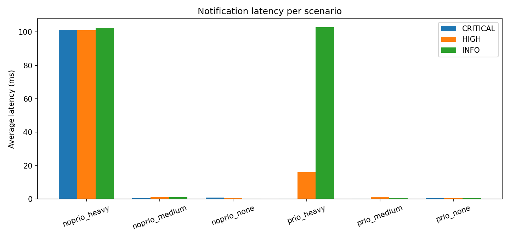

# Project 16 – Emergency Notification Network (UDP + SDN)

A UDP-based emergency notification system that sends urgent messages to many
subscribers. An SDN controller (Ryu, OpenFlow 1.3) identifies emergency traffic
and forwards it through a high-priority queue, so alerts still arrive quickly
when the network is congested.

## Requirements covered

| Requirement | Where |
|---|---|
| Implement UDP notification delivery | `server.py`, `subscriber.py` |
| Register multiple subscribers | `REGISTER` / `REG_OK` messages in `server.py` |
| Classify emergency traffic | DSCP 46 marking in `server.py`, matched in `sdn_controller.py` |
| Apply high-priority SDN forwarding | `sdn_controller.py` (queue 1) + OVS queues in `topology.py` |
| Delivery confirmation where required | ACK + resend for CRITICAL/HIGH alerts |
| Generate congestion scenarios | `congestion.py` (none / 8 Mbps / 15 Mbps) |
| Measure notification latency | subscriber logs + `analyze.py` |

## Files

```
protocol.py        ports, DSCP value, alert levels, message encode/decode
server.py          notification server (registration, alerts, ACK, resend, log)
subscriber.py      subscriber client (receive, ACK, latency log)
sdn_controller.py  Ryu controller: learning switch + emergency classification + queues
topology.py        Mininet topology, OVS queue setup, automatic experiment
congestion.py      background UDP flood + sink
analyze.py         latency / delivery report and chart
```

## Topology

```
   h1 (server 10.0.0.1)                     h2 h3 h4 h5 (subscribers)
         \                                   |  |  |  /
          s1 ========= 10 Mbps link ========= s2
         /                                    \
   h6 (flood sender 10.0.0.6)             h7 (flood sink 10.0.0.7)
```

The flood from h6 to h7 and the alerts from h1 to h2–h5 both cross the s1–s2
link, so that link is where congestion happens.

## Setup (Ubuntu VM)

```bash
sudo apt install mininet openvswitch-switch python3-matplotlib
pip install ryu            # Ryu works best on Python 3.8 / 3.9
# if ryu fails with an eventlet error:  pip install eventlet==0.30.2
```

## Running

**Terminal 1 – controller**
```bash
ryu-manager sdn_controller.py
```

**Terminal 2 – manual demo**
```bash
sudo python3 topology.py
mininet> h2 python3 subscriber.py --name h2 &
mininet> h3 python3 subscriber.py --name h3 &
mininet> xterm h1          # in the xterm:  python3 server.py
```
In the server window type alerts like `CRITICAL Fire in Block A` or
`INFO Library closes at 8`. Type `list` to see registered subscribers.

**Automatic experiment (all congestion scenarios)**
```bash
# run 1: SDN priority ON
ryu-manager sdn_controller.py
sudo python3 topology.py --experiment --tag prio

# run 2: SDN priority OFF (for comparison) – restart the controller like this
ENN_PRIORITY=0 ryu-manager sdn_controller.py
sudo python3 topology.py --experiment --tag noprio

python3 analyze.py
```
This creates `logs/prio_none`, `logs/prio_medium`, `logs/prio_heavy`,
`logs/noprio_...`, then `results/summary.csv` and `results/latency.png`.

**Testing without Mininet (one PC)**
```bash
python3 subscriber.py --server 127.0.0.1 --name s1 --port 6001 &
python3 subscriber.py --server 127.0.0.1 --name s2 --port 6002 --drop 0.3 &
python3 server.py --auto 30 --gap 0.05 --subs 2
```
`--drop 0.3` makes s2 ignore 30% of packets, so you can see the server resend
alerts until they are confirmed.

Useful checks inside Mininet:
```bash
sudo ovs-ofctl -O OpenFlow13 dump-flows s1     # see priority 200 / 150 / 10 rules
sudo ovs-vsctl list queue                      # see the two queues
```

---

## How it works (for the viva)

### 1. Message format
Every message is one UDP packet containing JSON. Example alert:
```json
{"type": "ALERT", "seq": 7, "level": "CRITICAL", "text": "Fire in Block A",
 "need_ack": true, "sent_ms": 1793696750279.9}
```
| type | direction | purpose |
|---|---|---|
| REGISTER | subscriber → server :5000 | join the list |
| REG_OK | server → subscriber | registration confirmed |
| ALERT | server → subscriber :5005 | the notification |
| ACK | subscriber → server :5000 | "I got alert #seq" |
| UNREGISTER | subscriber → server | leave the list |

### 2. Registration
h2 sends `{"type":"REGISTER","name":"h2"}` from 10.0.0.2:5005. The server
reads the sender address from the packet itself and stores `h2 → (10.0.0.2, 5005)`.
If the server is not up yet, the subscriber retries every 1 second.

### 3. Alert levels
| Level | ACK needed | DSCP | Queue |
|---|---|---|---|
| CRITICAL | yes | 46 | 1 (high) |
| HIGH | yes | 46 | 1 (high) |
| INFO | no | 0 | 0 (normal) |

### 4. Classifying emergency traffic
The server has two sockets. The emergency socket sets the IP TOS byte to 184.
TOS = DSCP × 4, so 184 = 46 × 4. DSCP 46 is the standard "Expedited Forwarding"
value. So every CRITICAL/HIGH packet carries the number 46 in its IP header,
and the switch can recognise it without opening the JSON.

### 5. SDN forwarding
When the controller learns where a host is (say h2 is on s2 port 1), it installs
three rules for packets going to h2:

| priority | match | action |
|---|---|---|
| 200 | UDP and DSCP = 46 | queue 1, port 1 |
| 150 | UDP to port 5000 (ACK/REGISTER) | queue 1, port 1 |
| 10 | anything else | queue 0, port 1 |

The switch checks the highest priority rule first. A CRITICAL alert matches the
priority-200 rule and goes to queue 1. A flood packet only matches the
priority-10 rule and goes to queue 0. ACKs also use queue 1, so the
confirmation is not delayed by the flood either.

### 6. Queues
Each switch port has an HTB queue setup with a 10 Mbps limit:
- queue 0 (normal): guaranteed 1 Mbps
- queue 1 (emergency): guaranteed 8 Mbps and served first

Example: h6 floods 15 Mbps into a 10 Mbps link. Queue 0 fills up with
hundreds of waiting packets. A CRITICAL alert arrives, goes into queue 1,
which is almost empty, so it leaves almost immediately instead of waiting
behind the flood.

### 7. Delivery confirmation
For CRITICAL/HIGH alerts the server keeps a "pending" entry per subscriber.
- Subscriber receives alert #7 → sends `ACK seq=7`.
- Server gets the ACK → removes pending entry, logs RTT, status DELIVERED.
- No ACK within 0.5 s → server resends (up to 3 times), then marks FAILED.
- If an ACK is lost and the alert comes twice, the subscriber recognises the
  repeated `seq` and does not show it again (but ACKs it again).

INFO alerts are "fire and forget": no ACK, no resend.

### 8. Latency measurement
The server writes `sent_ms` into each alert. The subscriber notes `recv_ms` when
it arrives. Latency = recv_ms − sent_ms. All Mininet hosts run on the same
machine and share one clock, so this one-way value is accurate.
Example: sent at 1000.00 ms, received at 1000.85 ms → latency 0.85 ms.

`analyze.py` reports for each scenario and level: average, 95th percentile,
maximum latency, delivery % and number of resends.

### 9. Expected results
| Scenario | Priority ON (CRITICAL) | Priority OFF (CRITICAL) |
|---|---|---|
| none | very low | very low |
| medium (8 Mbps) | low | rises |
| heavy (15 Mbps) | stays low | much higher, some resends/losses |

INFO alerts become slow under heavy flood in both runs, because they share
queue 0 with the flood. That difference is exactly what the SDN prioritisation
is supposed to show.
 
## Team 
 
Computer Networks course project 
 
- Pranav Anand (PES1UG25AM278) 
- Pratik Kankani (PES1UG25AM287) 
- Prabhudev Naik (PES1UG25AM269) 
 
 
